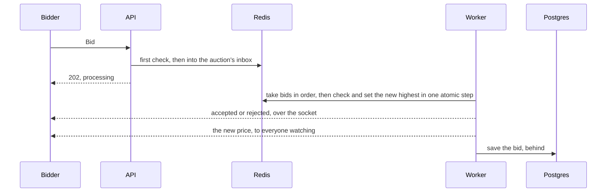

# bids/ — running an auction

Live auctions: a crowd bidding on one item, the price on every screen moving with each bid.

## The problem

bids/ runs every auction: one item (a trading card, say) sold to the highest bidder, even when a crowd bids in the same second.

Bidders can also set a maximum and let the platform bid for them, only as much as it takes to stay ahead (a proxy bid). The code runs from the bid button to the saved bid, and back to every screen watching.

## By the numbers

| Bids a second, one auction | Server errors | Bids in production |
|:-:|:-:|:-:|
| **~263** | **0** | **204** |

The first two come from a staging load test: 400 users on one hot auction for 8.5 minutes, 134,214 bids. Bids in production: the final database count.

Every user in the test bid the same amount at once, so only one bid per price step could win. The API turned 97.7% away as already beaten, and the worker accepted about one new highest bid a second. That is the auction's ceiling, not the worker's: it sat mostly idle.

The load test ran before the duplicate-bid fix below shipped.

An earlier design decided each bid inside a Postgres transaction, so bids on one auction queued behind each other. An earlier load test measured 1.1 seconds per bid, 92% of it in the database, and I moved the decision to Redis days later.

## The rules

| Rule | Enforced in | Proven by |
|---|---|---|
| Each bid beats the price by the step | [`bids.ts`](bids.ts#L140-L209) (the API's first check) · [`validate-and-accept.ts`](validate-and-accept.ts#L62-L126) (the deciding check, in Redis) | [first wins when amounts are equal](bids-sequential.test.ts#L32-L61) |
| One bid at a time, in arrival order | [`inbox.ts`](inbox.ts#L30-L48) · [`drain-bids.ts`](drain-bids.ts#L38-L66) | [inbox order](bids-sequential.test.ts#L63-L89) |
| A bid counts once | [`with-bid-idempotency.ts`](with-bid-idempotency.ts#L22-L53) · [`persist.job.ts`](persist.job.ts#L134-L159) (a repeat save is a success) | the worker's idempotency tests, not in this folder |
| A late bid gives everyone time to answer | [`bids.ts`](bids.ts#L27-L64) · [`drain.job.ts`](drain.job.ts#L110-L135) | the worker's extension tests, not in this folder |
| A proxy bids just enough to stay ahead | [`proxy.ts`](proxy.ts#L29-L43) · [`validate-and-accept.ts`](validate-and-accept.ts#L97-L109) (a proxy may match the price) · the proxy ranking in Redis, earlier first on a tie, not in this folder | the worker's proxy tests, not in this folder |
| The price on screen never steps backwards | [`store.ts`](store.ts#L59-L117) | none: the web app has no tests |

## How a bid works

## Why it's built this way

### 1. One inbox per auction, one reader

- Every bid goes into the auction's inbox, first in, first out. Bids from a person and bids a proxy places go through the same inbox.
- One drain job per auction reads it, so bids are judged one at a time, in the order they arrived.
- One inbox per auction keeps that order while a busy auction never slows another.

### 2. Redis judges the bid, Postgres saves it after

- Earlier: each bid was decided inside a Postgres transaction, 1.1 seconds a bid under load.
- Now one Lua script in Redis checks the bid and sets the new highest in one step. The worker queues the save and moves on.
- The winner isn't settled until the accepted bids are saved, waiting at most five seconds.

### 3. The bid request returns at once

- The API answers 202 as soon as the bid is in the inbox. The verdict comes over the realtime socket the page already holds, so nothing polls.
- A bid shows as placed only on that verdict.
- A verdict can arrive before the page starts waiting for it. The page keeps it until then (`f7fb5bbb4`).

### 4. Only the worker writes the cached price

- The API reads the auction from the cache. On a miss it reads Postgres but never writes the cache back.
- That is the fix for the duplicate-bid bug below: the API's slower read could overwrite a price the worker had just set.

### 5. A "has new bids" flag on top of the one job

- With one job per auction, a bid pushed while the job is finishing is dropped as a duplicate job and waits for the next bid.
- The bid also sets a flag, and the running job goes round again while it is set.
- A small window remains: a bid that lands after the job reads the flag clear, but before the job ends, waits for the next bid. I rejected a lock for it ([`drain-bids.ts`](drain-bids.ts#L13-L15)): it "would cause retry storms".

## Start here

1. [`drain-bids.ts`](drain-bids.ts#L38-L66): the drain loop, going round while the flag is set, bids taken in order.
2. [`validate-and-accept.ts`](validate-and-accept.ts#L62-L126): the deciding check, one atomic step in Redis.
3. [`drain.job.ts`](drain.job.ts#L25-L292): one bid's verdict, the late-bid extension, the save queued, the answer sent.

## Bugs I fixed

### Two bids could win at the same price
- **What:** when an auction's price wasn't in the cache yet, two bids at the same exact moment could both miss the first one and both be accepted.
- **In production:** Jan 2 to Feb 5. It needed two people bidding in the same moment on an auction not yet cached; caught in load testing, and nothing on record shows it happened in production.
- **Fix:** `ec2700fdf`

### A proxy's tie bid was turned away
- **What:** a proxy may match the current price to break a tie, but the Redis check demanded more than the current price.
- **In production:** Jan 2 to Jan 27. Auctions were rare then and, as far as I know, no one set a proxy, so it never fired.
- **Fix:** `822525194`

### "You've been outbid" while your proxy was still bidding
- **What:** the email went out the moment a bid passed you, before your proxy answered. Now it waits five seconds and is sent only if you're still beaten.
- **In production:** Jan 18, when outbid emails started, to Feb 23. No one set a proxy in that time either, so it never fired.
- **Fix:** `097423fd7`

## What I'd change now

- **A reliable queue.** The drain takes a bid out of the inbox before judging it ([`inbox.ts`](inbox.ts#L43-L48)), so a crash before its save is queued ([`drain.job.ts`](drain.job.ts#L140-L154)) loses it: nothing else holds it. If Redis had accepted it, later bids are judged against a price Postgres never saves. I'd move each bid to a processing list (`LMOVE`), deleted once saved.
- **No bid left waiting.** A bid that lands as the drain is finishing waits for the next bid ([`drain-bids.ts`](drain-bids.ts#L13-L15)). I'd hand off in one Redis step: a bid starts a drain only when no "running" mark is set, and the drain clears that mark only in the same step that finds the inbox empty. No lock, so no retries.
- **One argument, not seven.** The API's bid function takes seven arguments by position ([`place.ts`](place.ts#L165-L173)). One named object would read at the call site.
- **Plain awaits in the save.** The save runs its writes through `Promise.all` inside one transaction ([`persist.job.ts`](persist.job.ts#L35-L66)). A transaction holds one connection, which runs one query at a time, so nothing runs in parallel. Awaiting each write in turn says what actually happens.
