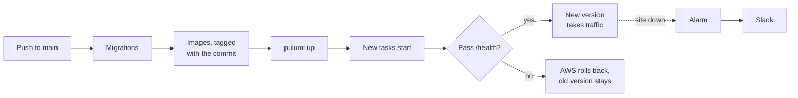

# infra/ — NoLie on AWS, written as code

How we ran NoLie on AWS: a fix reaches production in about eight minutes, a broken version rolls itself back, and an outage reaches Slack.

## The problem

infra/ is how we ran NoLie on AWS, written as code. A merged fix reached production in about eight minutes. A new version only took over once it was healthy, and rolled itself back if it wasn't. If the site went down anyway, AWS told us in Slack within a minute or two.

The next engineer gets these rules without writing a line.

The services and their rollback are in [`ecs.ts`](ecs.ts), the alarms and the budget in [`monitoring.ts`](monitoring.ts), and [`deploy.yml`](deploy.yml) builds each version and hands it to them.

## By the numbers

| Production deploys | Requests without a server error | Hours with no healthy server | AWS usage |
|:-:|:-:|:-:|:-:|
| **169** | **99.995% of 3.60M** | **0** | **$744 → $230/month** |

Production, Feb 5 to Sep 21, 2026: no six-hour window of 913 without a healthy API target. A drop shorter than a health check would not show. 167 of the 169 deploys were green. Usage is February against August, the last full month, before credits, which covered all of it.

## The rules

| Rule | Enforced in | Proven by |
|---|---|---|
| A merged change is live in minutes | [`deploy.yml`](deploy.yml#L9-L13) (every push to main deploys) · [`deploy.yml`](deploy.yml#L172-L174) (the web build waits on nothing but change detection) | GitHub Actions: 167 green production deploys, median 8.4 minutes |
| A failed deploy undoes itself | [`ecs.ts`](ecs.ts#L365-L368) (API) · [`ecs.ts`](ecs.ts#L408-L411) (worker) · [`ecs.ts`](ecs.ts#L184-L196) (the health check) | the prod stack export: rollback on for both services |
| Each deploy is a distinct, tagged version | [`ecs.ts`](ecs.ts#L47-L56) (no tag, no deploy) · [`deploy.yml`](deploy.yml#L130) (tagged with its commit) | the prod stack export: both services run the image tagged with commit `d5943e0ac` |
| The old version serves meanwhile | AWS's default, not set here: 100% kept up, 200% at most | the prod stack export |
| An outage, and its recovery, reach Slack | [`monitoring.ts`](monitoring.ts#L100-L123) (API) · [`monitoring.ts`](monitoring.ts#L125-L149) (worker) · [`monitoring.ts`](monitoring.ts#L70-L77) (Slack) | a latency alarm firing and clearing in Slack, Jul 15 |
| A spike can't quietly run up the bill | [`ecs.ts`](ecs.ts#L419-L425) (the task cap) · [`monitoring.ts`](monitoring.ts#L512-L538) (the budget) | the prod stack export: cap 100, budget on gross spend |

## How a deploy runs

## Why it's built this way

### 1. As code, not clicks
- I wrote the whole setup in Pulumi so it was portable, and rebuilding it never depended on a run of clicks in a console.
- Changes went through a commit and the same pipeline: 149 updates to the prod stack.

### 2. AWS, not Render
- We moved off Render because its DDoS protection answered real traffic with false 429s under heavy load.
- On AWS the rate limiting is ours, and the load balancer feeds the autoscaler directly.

### 3. The rollback is AWS's, and it needs a new version to compare
- The circuit breaker only rolls back what it can tell is a new deployment. A reused tag like `latest` would look like no change.
- So CI tags each image with its commit, and the stack refuses to deploy without one. A service that didn't change keeps its current tag.

### 4. Alarms on free metrics, missing data counted as down
- Container Insights cost about $16 a month, and only the two outage alarms used it. I moved them to free metrics (`a504ad117`).
- The API alarm watches the load balancer's healthy targets. The worker has no load balancer, so a worker that sends no metrics at all is the alarm.
- Either way, no data means down. A service with no tasks reports nothing, and silence must not read as fine.

### 5. A cap and a budget
- The API could scale to 480 tasks, about $8.6k a month if traffic held it there, with no alarm on it. Before an expected traffic spike, a load test on 100 tasks, four times the size prod ran day to day, served 10,695 requests a second with no errors. So I cut the cap to 100 (`71f899fc0`).
- The budget watches gross spend. Credits kept our net bill at $0, so a default budget would never have fired.

### 6. Fast deploys, everything that can run at once does
- I kept deploys fast to keep momentum going and fixes rolling out quickly. A merged change reached production in 8.4 minutes at the median.
- The web build starts right after change detection and never waits on the database. The API and worker images build side by side once migrations pass.
- Only what changed is rebuilt. An unchanged service keeps its current image, so a web-only change never restarts the API.
- Integration tests ran on the pull request, before the merge, so they never held a deploy up.

## Start here

1. [`ecs.ts`](ecs.ts#L320-L369): the API service, from its health-check grace to the rollback.
2. [`monitoring.ts`](monitoring.ts#L100-L149): the two outage alarms, and why missing data counts as down.
3. [`deploy.yml`](deploy.yml#L196-L262): the deploy job, keeping an unchanged service's tag, then `pulumi up`.

## Bugs I fixed

### API errors were labeled for an environment the Slack alert didn't watch
- **What:** Sentry's Slack alert watched the "production" environment, but the services reported "prod", the stack's name.
- **In production:** from the first deploy, Feb 5, until May 28 for the worker and Jun 2 for the API.
- **Fix:** `cf016adaf` (worker) · `a2fa02502` (API)

### A cost monitor broke the prod deploy
- **What:** AWS allows one spend monitor of its kind per account and had already made one, so creating ours failed the deploy partway.
- **In production:** Jul 26. The site kept serving: two healthy targets in every window that day. Green again in 21 minutes.
- **Fix:** `40c9d5d25`

## What I'd change now

The deploys held: no window without a healthy server. Two things I'd set up differently.

- **Keep slow endpoints out of the latency alarm.** Some endpoints are slow by design, like the AI writing a listing from its photos, which could take a few seconds. The latency alarm watched every request at once, so those calls set it off with nothing wrong.
  - **How:** the load balancer can't tell endpoints apart, so I'd send the slow ones to their own target group from the start, and point the latency alarm at the fast group, not the whole load balancer.

- **Deploy what changed since production, not since the last push.** The deploy rebuilt a service only when the latest push touched it. On Jul 26 a deploy failed after building new images, and the fix touched only the infrastructure, so the redeploy kept the old ones.
  - **What that cost:** the worker's new image never ran until Sep 4. It held a change to staging's schedules only, so production behaved the same. Two pushes close together leave the same gap, since GitHub drops a queued run when a newer one arrives.
  - **How:** compare each service against the commit production runs, which the stack already exports. A failed or dropped run is then caught by the next one.
