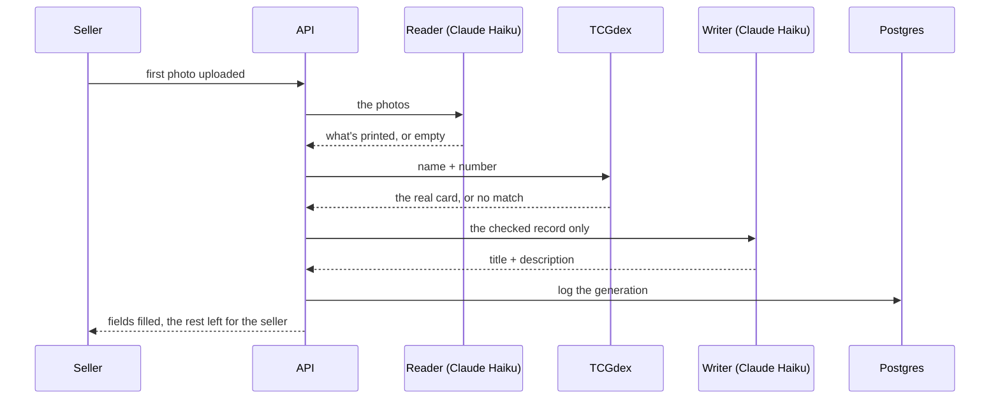

# listing/ — listing from photos

Take photos, and the listing writes itself.

## The problem

listing/ lets a seller create a listing on the marketplace from just its photos: the AI reads the photos and fills in everything it can check.

This folder is the two AI calls, the card lookup between them, the log of every generation, and the browser half that hands the result to the seller.

## By the numbers

| Listings on NoLie | Time to list an item |
|:-:|:-:|
| **3,631** | **under 1 minute** |

Listings: every listing when NoLie closed in September, not only the AI-filled ones. Time to list: a creator timed it on camera, from photos to a live listing.

## The rules

| Rule | Enforced in | Proven by |
|---|---|---|
| Copy only for a card a database confirms | [`canonical-lookup.ts`](canonical-lookup.ts#L241-L294) (no match: set, number and rarity dropped) · [`generate-listing.ts`](generate-listing.ts#L178-L194) (no match: empty title and description) | not tested |
| A bad cert number drops, not the listing | [`listing-extraction.ts`](listing-extraction.ts#L71-L106) (the prompt) · [`grading.ts`](grading.ts#L61-L69) (the format per grader; the drop runs in the route and on create) | the create tests in the production repo, not in this folder |
| A rerun never overwrites the seller's typing | [`use-listing-ai.ts`](use-listing-ai.ts#L150-L174) (an edited field gets a suggestion instead; the exception after a failed first run is under What I'd change) | not tested |
| Every generation logged, linked to its owner only | [`generation.ts`](generation.ts#L54-L86) (written on the server) · [`generation.ts`](generation.ts#L110-L135) (linked once, owner only) | [owner only](generation.test.ts#L206) · [linked once](generation.test.ts#L238) |

## How it works

The writer never sees the photos, and an ungraded card with no match never reaches it: the seller gets empty fields.

## Why it's built this way

### 1. The AI's reading is checked against a real card

- **A record, not a guess.** The reader returns the name and number off the card; TCGdex, a public card database, must find that card. The set, number and rarity in the listing come from TCGdex's record.
- **No match, no copy.** For an ungraded card with no match, the AI writes nothing. Only Pokémon has a database wired in, so every other ungraded card is left to the seller.
- **Slabs are read off the label.** A grader prints the card's details on the slab, and the cert lets any buyer check them on the grader's site.
- **Each language searched in its own.** Japanese, Korean and Chinese cards search TCGdex in their language ([`canonical-lookup.ts`](canonical-lookup.ts#L52-L64)).

### 2. The AI's confidence is never what decides

- The reader reports a confidence from 0 to 1. Nothing branches on it: it's logged and kept, never trusted to fill a field.
- A card's set, number and rarity come from a database match, and a slab's details from its label. The year and language come from the AI's reading, and its category is a pre-fill the seller confirms.

### 3. Reading and writing are two separate AI calls

- The reader only extracts what's printed and never writes copy. The writer only sees the checked record, never the photo, so it can't invent a card's details from memory.
- I chose this over one call that reads and writes at once.

### 4. Every generation is logged

- One row per AI run since June 8, written on the server: the model, the prompt and schema versions, the AI's raw reading, the matched record, and the suggested copy.
- **Abandoned runs too.** Re-runs are grouped by the seller's session. Writing the row is best-effort: a failure is reported and the seller carries on.
- **AI against seller, side by side.** When a listing is created from a run, the row links to it. Everything the AI suggested (title, description, the card's details, the category) can be compared with what the seller published.
- **For debugging and for training.** Those edits show what sellers want: the data to fix a prompt with, or to train our own model on.
- **The browser can't change it.** The prediction is stored server-side, so a client can't fake a correction.

### 5. The seller's words win

- Only the first photo starts a generation; more angles don't, so accepted text isn't replaced ([`use-generate-listing-from-photos.ts`](use-generate-listing-from-photos.ts#L22-L37)).
- If a re-run lands on a field the seller edited, it waits as a suggestion.

## Start here

1. [`canonical-lookup.ts`](canonical-lookup.ts#L241-L294): the AI's reading checked against TCGdex, and what's dropped on a miss.
2. [`generate-listing.ts`](generate-listing.ts#L178-L194): no match, no copy.
3. [`generation.ts`](generation.ts#L44-L86): the log of every generation, and why it's written on the server.

## Bugs I fixed

### Made-up rarities and wrong card numbers on ungraded cards
- **What:** the writer trusted every field, so the AI's own guesses ("Holo Rare" on a non-holo) reached the copy. Japanese cards always missed TCGdex, since the language was mapped wrong.
- **In production:** yes, May 4 to May 10. I caught it in production and fixed it as soon as I spotted it.
- **Fix:** `67b226d8b`

### Made-up cert numbers on TAG slabs
- **What:** TAG, a grading company, prints its cert along the slab's side edge, so with only the front in the photo, the AI invented a plausible number.
- **In production:** no. The fix shipped in the same release as the feature, May 4.
- **Fix:** `f013cab43`

### "091/86" instead of the card's "091/086"
- **What:** TCGdex pads the card's number but not the set's total, so the listing showed a number the card doesn't print.
- **In production:** yes, May 10 to June 27. Caught in production, which is how I knew to fix it.
- **Fix:** `033a59c7a`

## What I'd change now

- **Match the whole printed number.** The lookup takes the first card with that name and number, and ignores the set's total ("4/102"). TCGdex holds four Charizards numbered 4 and lists Base Set 2 first, so a Base Set Charizard could be listed under the wrong set ([`canonical-lookup.ts`](canonical-lookup.ts#L122)).
- **Version the writer too.** The log records the reader's model and prompt version, but not the writer's, so a logged title can't be traced to the prompt that wrote it.
- **Protect typed text after a failed run.** If the first generation fails, the seller types, then swaps the first photo, the new result overwrites what they typed: the "first result" path skips the edited-field check ([`use-listing-ai.ts`](use-listing-ai.ts#L136-L147)).
- **One reducer for the AI state.** Seven pieces of state are kept in step by an effect that runs on every keystroke. A reducer would make each transition one named step.
