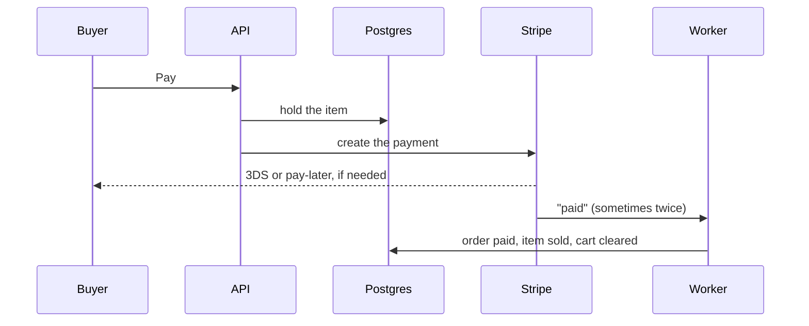
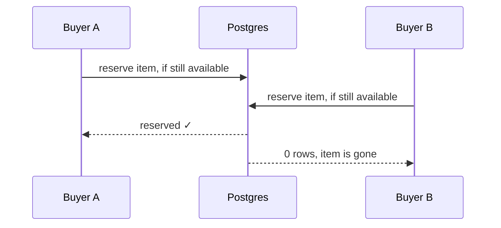

# payments/ — charging buyers

Checkout for one-of-a-kind items: one item, one buyer, one charge.

## The problem

Checkout is the one path where a bug costs money and trust at once. Every listing on NoLie is a single item with no second copy, so payments/ charges each buyer once, for an item they get, and sells each item to one buyer.

The code takes a buyer from cart to paid order, and holds even when the app, the network or Stripe sends something twice.

## By the numbers

| Payments | Total charged | Double charges |
|:-:|:-:|:-:|
| **336** | **$13,547** | **0** |

Marketplace payments, May to September 2026: checkout and accepted offers.

## The three rules

| Rule | Enforced in | Proven by |
|---|---|---|
| A buyer pays once | [`idempotency.ts`](idempotency.ts) · [`resume-guard.ts`](resume-guard.ts#L26-L146) · [`finalize-tx.ts`](finalize-tx.ts#L535-L544) | [idempotency replay](claim.test.ts#L1154) |
| One item, one buyer | [`claim.ts`](claim.ts#L568-L745) (the hold) · [`finalize-tx.ts`](finalize-tx.ts#L574-L576) (sold only if still held) | [race-to-claim atomicity](claim.test.ts#L948) |
| No charge without the item | [`payment-intent-succeeded.ts`](payment-intent-succeeded.ts#L148) (the lost race refunded) | the worker's webhook tests, not in this folder |

## How a purchase works

## Why it's built this way

### 1. Whoever taps Pay first gets the item

Stripe confirms a successful payment asynchronously, by webhook. If someone else tapped Pay during that confirmation window, two people could buy the same item.

- The hold is a conditional write in Postgres, one per seller in the cart. Two buyers at once: exactly one wins.
- The webhook marks the item sold only if this order still holds it. A sweeper frees lapsed holds every two minutes.
- A hold lasts 10 minutes, long enough to finish 3DS, or 25 for Affirm or Klarna. The buyer sees no countdown.
- The hold is taken at Pay, not at add-to-cart: a cart hold would let anyone block an item without ever buying it.
- If a hold lapses and someone else takes the item, the late payment is refunded automatically. The hold keeps that rare.

### 2. A reused key can't charge the wrong cart

- Each Pay carries an idempotency key, and the claim stores a fingerprint of what it was for.
- Same key, same cart: the first answer comes back.
- Same key, different cart or item: rejected, never charged.

### 3. Coming back from 3DS never opens a second charge

- A buyer returning from 3DS or Affirm gets a new key, so the key can't catch it.
- The guard matches on the items instead. Not charged yet: cancel and start fresh. Already charged: send them to that order.

### 4. Stripe can say "paid" twice; finalize acts once

- Every write in finalize only applies to an order still pending.
- The second "paid" changes nothing.

## Start here

1. [`idempotency.ts`](idempotency.ts): the fingerprint a replay is checked against. The check itself is [`replayIfExists`](claim.ts#L984-L1033) in `claim.ts`.
2. [`resume-guard.ts`](resume-guard.ts#L26-L62): the three outcomes for a returning buyer.
3. [`finalize-tx.ts`](finalize-tx.ts#L466-L576): paid, sold and cart cleared in one transaction; a repeat "paid" spotted at line 535, a lost race at 574.

## Bugs I fixed

### A declined card trapped the buyer
- **What:** a retry after a decline couldn't charge. A cart cleared before the charge shipped in the same release as the fix, so buyers never saw it.
- **In production:** 8 days, Apr 30 to May 9. No buyer hit it; Stripe shows no declined charge in that window.
- **Fix:** `e61ef34cb`

### A repeat "paid" would have refunded a paying buyer
- **What:** a second webhook looked like a lost race, and the race path refunds.
- **In production:** Apr 30 to May 26. Never fired: since launch, every refund in the Stripe export carries a refund-record id, and this path sets none.
- **Fix:** `54250b648`

### Coming back from 3DS could charge twice
- **What:** a returning buyer could open a second payment for the same items.
- **In production:** possible for card payments, Apr 30 to Jun 19. Never happened: a second charge for the same item is caught as a lost race and refunded, and that refund never ran.
- **Fix:** `3efb7c37c`

### A guest could inherit someone else's account details
- **What:** guest checkout picking up a matched account's Stripe customer, phone or tax exemption.
- **In production:** no. Guest checkout shipped on Jun 23, in the same release as all three fixes.
- **Fix:** `27b69f84c` · `5f6460a4a` · `bf70e99cd`

## What I'd change now

The logic held up. The shape is what I'd change.

- **Split it into named steps.** `claimCheckout` is one 740-line function. To follow it, you have to remember everything that happened above. Each step would be its own small function, and the top would read like the checkout itself.
- **The same for finalize.** Seven business steps sit in one 280-line function: mark paid, clear the cart, mark sold, cancel competing offers, record earnings, create labels, capture credit. Each would get a name.
- **Make the repeat check explicit.** Today a repeat "paid" is spotted because zero orders changed. It's the line that prevents a wrong refund, and it should read like one.
- **Move shipping out.** Label presets and bundle dimensions live inside the payment code. They belong to shipping.
