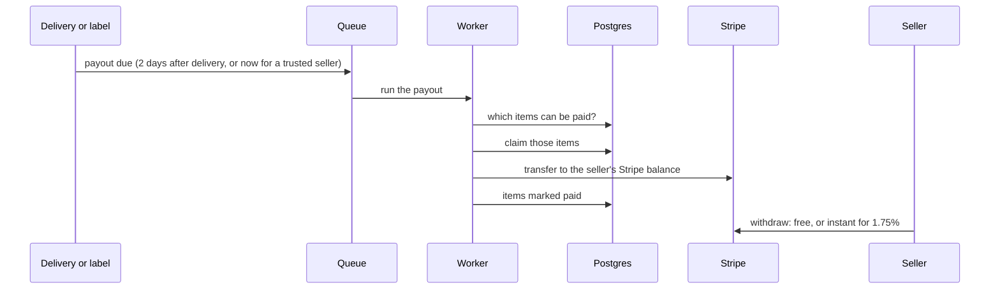

# payouts/ — paying sellers

A seller is paid for every sale they bring to the marketplace, and moves the money to their bank whenever they like.

## The problem

Payouts landing are what keep a seller coming back to list the next item. payouts/ pays a seller for every item the buyer keeps, onto the seller's own Stripe balance.

This folder is the logic that decides which items are paid, sends the money, and lets the seller take it out.

## By the numbers

| Paid to sellers | Transfers | Sellers paid |
|:-:|:-:|:-:|
| **$18,059** | **462** | **84** |

Every transfer to a seller's Stripe balance, January to September 2026, NoLie's own store is one of the 84, paid $5,735 for its April sales.

## The rules

| Rule | Enforced in | Proven by |
|---|---|---|
| Paid once per item | [`release.job.ts`](release.job.ts#L457-L468) (each item claimed for this payout, before Stripe is called) · [`pay.ts`](pay.ts#L67-L89) (one key per transfer) | [parallel runs, one transfer](payout-release.test.ts#L789) · [no second payment after the first](payout-release.test.ts#L899) |
| Not for a refunded item or cancelled order | [`releasable.ts`](releasable.ts#L157-L160) · [`release.job.ts`](release.job.ts#L230-L241) | [no payout after a full refund](payout-release.test.ts#L1002); the cancelled order isn't tested in this folder |
| A disputed item holds back only itself | [`releasable.ts`](releasable.ts#L131-L178) | [only the clean items paid](payout-release.test.ts#L413) · [the held item paid once settled](payout-release.test.ts#L453) |
| Paid 2 days after delivery | [`payouts.ts`](payouts.ts#L8-L26) · [`release-on-fulfillment.ts`](release-on-fulfillment.ts) | the delay is applied by the delivery handlers, not in this folder |
| Trusted sellers paid at the label | [`release-early.ts`](release-early.ts#L52-L68) · [`release.job.ts`](release.job.ts#L605-L623) | [paid before delivery](payout-release.test.ts#L113) · [an early payout comes from NoLie's balance](payout-release.test.ts#L1117) |
| The seller's own balance; withdraw free or instant | [`pay.ts`](pay.ts#L67-L89) · [`payouts.ts`](payouts.ts#L144-L166) · [`withdrawals.ts`](withdrawals.ts#L297-L360) | not tested in this folder |

## How a payout works

## Why it's built this way

### 1. The items are the lock against paying twice

- A payout claims its items in one database transaction before it calls Stripe. A second run for the same sale claims nothing and stops.
- Stripe is called only after the claim commits, never while the lock is held.
- Each transfer has its own id, sent to Stripe as the idempotency key, so Stripe treats a repeat of the same call as the same transfer.
- My first fix was a unique index on the unfinished transfer. Its slot freed the moment the first transfer finished, so a late second run could still pay. I put the claim in front of it; the index stays as a backstop, and still guards old payouts that predate per-item rows.

### 2. Pay per item, not per order

- A cart can hold several items from one seller. One dispute used to hold back the whole order's payout.
- Now each item is paid on its own: the clean items go out now, and the disputed one waits for the outcome.
- A refunded item is never paid. An item NoLie refunded at its own cost is paid in full.

### 3. NoLie never holds a seller's cash

- Paying out and withdrawing are two separate steps. The payout lands on the seller's own Stripe balance; the seller chooses when to move it to the bank.
- Before, Stripe swept every payout straight to the bank, and the seller had no say over when.
- Stripe holds the money for the seller, which keeps NoLie out of money-transmitter rules.
- The seller withdraws when they like: free, or instant for 1.75%.

### 4. Two days, to cover the dispute window

- A buyer can dispute for 2 days after delivery. The payout used to go out after 1, so a seller could be paid while the buyer could still dispute.
- The window now matches the dispute window, so a seller is never paid while the buyer can still dispute.
- A letter has no tracking, so it is paid 7 business days after its label.

### 5. Trusted sellers are paid at the label

- Being paid and the item arriving are two separate clocks. A trusted seller's payout fires when they buy the label; the dispute window still starts at delivery.
- The buyer's payment hasn't cleared by then, so an early payout comes from NoLie's own Stripe balance and the seller can withdraw it the same day.

## Start here

1. [`releasable.ts`](releasable.ts#L131-L178): which items are paid this run.
2. [`release.job.ts`](release.job.ts#L406-L527): the claim that stops a second payment.
3. [`release-early.ts`](release-early.ts#L52-L68): a trusted seller paid when they buy the label.

## Bugs I fixed

### Two payouts at once could pay a seller twice
- **What:** two runs for the same sale could each send a transfer.
- **In production:** May 14 to May 16. Never happened: Stripe's transfers export shows 3 transfers in those days, and none repeats a seller and amount on one payment.
- **Fix:** `a704c7841` · `8f6552f13`

### Orders paid partly with credit couldn't pay the seller
- **What:** the transfer was tied to the buyer's card payment, which was smaller than the seller's share once store credit covered part of the order. Stripe rejected it.
- **In production:** until Jun 2. One payout failed and Sentry flagged it. Once the fix shipped, a script re-ran the payout and the seller was paid.
- **Fix:** `166a12440`

### A refund NoLie absorbed would have stalled the seller's payout
- **What:** when NoLie refunds the buyer and still pays the seller in full, the refunded card payment can't fund the transfer, so the payout failed and retried.
- **In production:** May 18 to Jul 11. Never fired.
- **Fix:** `c4d303156`

### A seller could be paid while the buyer could still dispute
- **What:** payouts went out 1 day after delivery, inside the 2-day dispute window.
- **In production:** until Jul 1. Two sellers were paid for items they never shipped, and I took the three payouts back by hand in Stripe (transfers export).
- **Fix:** `299548727`

## What I'd change now

- **Retry a failed payout when the seller fixes their details.** Today a payout that fails on the seller's account stays failed. Stripe tells us when the account is fixed, and that should send the payout again on its own.
- **Batch the emails.** Every payout sends its own email, so ten sales in an hour mean ten emails. One summary per batch would say the same thing.
- **Take back a payout from the admin panel.** The three payouts I took back were done by hand in the Stripe dashboard. The admin had no way to do it.
- **Split the payout job into named steps.** `release` is one function of about 840 lines: checks, which items to pay, the claim, which balance pays, the transfer, the result. Each would be its own small function, as in payments.
- **Record where a refund went.** The job [works out what's left on the buyer's card payment](release.job.ts#L585-L603) from order totals, because a refund doesn't store how much went back to the card and how much to store credit. Both credit bugs above came from that arithmetic.
