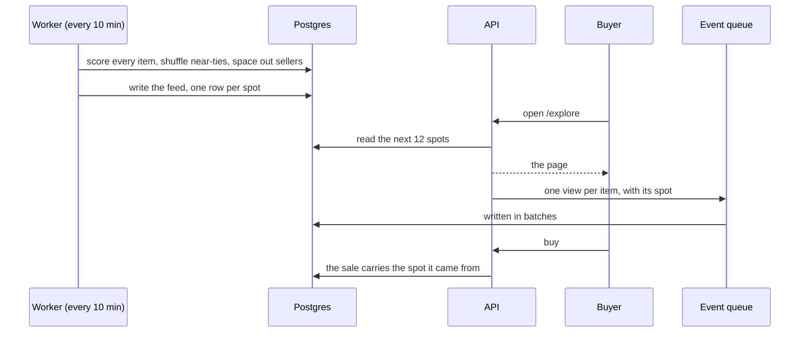

# ranking/ — the explore feed

The items buyers want, first on their screen.

## The problem

ranking/ puts the items we want buyers to see at the top of the feed, so they keep scrolling and buying. Every view and sale is logged with where it was on the feed, so we learn what buyers want.

This folder is the worker that orders the feed every 10 minutes, the API that serves it a page at a time, the browser half that keeps the logging honest, and the writer that stores every event.

## By the numbers

| Versions of the score | Feed views logged with their spot | Daily views, sold vs unsold |
|:-:|:-:|:-:|
| **11** | **102,880 of 102,880** | **4.4×** |

Versions: the score reached its 11th by June 12, and I retuned it in 33 commits from May 17 to June 30, 2026. Views: every feed view logged by June 5. Daily views: the median sold item against the median unsold one.

## The rules

| Rule | Enforced in | Proven by |
|---|---|---|
| Live auctions first, ending soonest | [`ranking.ts`](ranking.ts#L1329-L1344) · [`ranking.ts`](ranking.ts#L1417-L1419) | [auctions untouched](ranking.test.ts#L1336) |
| Then the freshest items | [`ranking.ts`](ranking.ts#L1190-L1236) · [`refresh.job.ts`](refresh.job.ts#L1012-L1032) | [fresher first](ranking.test.ts#L1543) · [lifts on top](ranking.test.ts#L1561) |
| Cards before merch and cheap items | [`ranking.ts`](ranking.ts#L1201-L1210) | [below every eligible item](ranking.test.ts#L1520) |
| At most 2 per seller in any 12 | [`ranking.ts`](ranking.ts#L1461-L1528) | [deferred, never dropped](ranking.test.ts#L1177) |
| Every view logs its spot | [`feed-serve.ts`](feed-serve.ts#L227-L238) · [`write.job.ts`](write.job.ts#L110-L158) | the production repo's tests |
| Every sale logs its spot | [`materialize-orders.ts`](materialize-orders.ts#L252-L286) | the production repo's tests |

## How it works

## Why it's built this way

### 1. Freshness leads, because there was too little data to rank on

- The score reached its 11th version in under four weeks. Each sparse signal misbehaved in its own way.
- A popularity boost built on cart adds and sales rewarded a lack of evidence: 24 of 940 listings got any boost, and popular characters got none.
- Seller reviews sat at a low weight because only a handful of 50 sellers had any.
- A feed led by engagement (views, saves, cart adds) barely moved between runs, so it looked like nobody was posting.
- So the live order leads with freshness, which halves every 30 hours; a popular character, a top condition or a grading lifts an item. Items under $15, merch, accessories and art sit below the rest, and how much buyers viewed, saved and carted an item stays as one lift. It is one switch away from the engagement order.

### 2. The feed is written ahead, not computed per request

- The worker writes the whole order into a table every 10 minutes; a page is a range read of 12 spots.
- A scroll keeps the run it started on, so pages never reshuffle under the buyer.
- A run that crashes halfway is rerun from scratch and lands the same order.
- If the written feed is missing, the API falls back to an in-memory order, then to a plain order: auctions ending soonest, then newest. A bad run can't break /explore.

### 3. A seeded shuffle replaces a frozen top

- Items swap places every 10 minutes: the top barely moves, and a deep item, even merch, can jump far up, so new items get recurring looks.
- Live auctions are left out of the shuffle, so they stay ending soonest; the seller cap still spaces them out.
- The shuffle is seeded by the run, so a retry reproduces it.
- It looks at rank only, never at engagement, so it can't pin old popular items back on top.

### 4. A sliding cap, not a global one

- The first cap sent a seller's items past the cap to the end of the whole feed.
- I lowered the cap from 3 to 2 after one seller's items held the top 3 spots, then made it a sliding window.
- It holds on the feed with no filter set, while other sellers have items left, and removes nothing.
- The count restarts where the auctions end and buy-now items begin, and a seller's repeat of the same title goes to the end.
- On a replay of June data, a seller with 69 listings showed at spots 8, 17, then 153 or later. With the sliding window: 8, 18, 33, 41, 47.

### 5. Log every spot now, train later

- A model that learns ranking needs to know where each item was shown, and what sold from where.
- With so few sales, testing one ranking against another wasn't possible, so I logged instead, for a richer recommender once data is no longer the limit.
- A tab refocus in the browser doesn't count as a new view.
- Events are written up to 100 at a time, or after a second. A job counts as done only once its batch is written, and a duplicate is dropped by its event id.

## Start here

1. [`refresh.job.ts`](refresh.job.ts#L961-L1073): the run that orders the feed, step by step: score, sort, shuffle, space out sellers, write.
2. [`ranking.ts`](ranking.ts#L1190-L1236): the live score, freshness first, the items that sit below, and the lifts.
3. [`write.job.ts`](write.job.ts#L37-L171): how every event is stored: batched, retried, and kept once.

## Bugs I fixed

### Sales were never credited to the spot that sold them
- **What:** the spot a buyer came from was dropped before the order was written, on both the cart and the Buy Now path, and accepted offers carried none.
- **In production:** May 22 to June 6, 2026. 0 of 212 checkout sales and 0 of 24 accepted offers were credited.
- **Fix:** `7a57058d7`

### Page 2 views never matched their clicks
- **What:** every page of a scroll logged its views under a new id, while the browser credited every click to the first page's id. Item page views were all logged as anonymous.
- **In production:** until June 6, 2026.
- **Fix:** `c9110d82a`

### A page-1 policy pinned old items above new ones
- **What:** a policy held "proven" items at the top of page 1, and against the new score only old, much-viewed items qualified, so old items sat above new ones that scored higher.
- **In production:** about 5 hours on June 26, 2026, from the new score's release to the fix.
- **Fix:** `bfc471302`, then the seeded shuffle `2acdefb4e`

## What I'd change now

The logging was the right bet. Around it, I'd change three things.

- **Pick the feed by the score it serves.** The feed build takes the top 5,000 items by the older engagement score, then re-scores them by freshness. A new item outside those 5,000 never gets its freshness counted. Every listing fit, so it never bit; at scale it would ([`refresh.job.ts`](refresh.job.ts#L1000)).
- **Give the score its own table.** The order has one, but the score is a column on the listing row, rewritten every 10 minutes, and the freshness score that served is never stored. A score table would let the build pick by the score it serves, which fixes the point above.
- **Build for the catalog we had.** Three serving paths with fallbacks and a feed written ahead, for a few thousand listings: one sort per run would have done. The code is forward-looking, and where that paid off was the data, not the serving.
