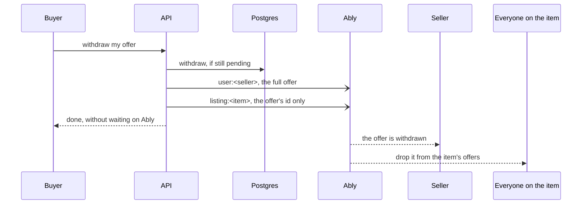

# realtime/ — live screens

Bids, offers and pickups on screen the moment they happen, with no refresh.

## The problem

Some moments shouldn't wait for a refresh: a bid placed or beaten, an offer received, countered or accepted, a pickup confirmed the moment the seller scans the buyer's code. realtime/ keeps every user's screen live for those.

This folder is the channels and who may hear them, the server's publishers, the browser's client, and one offer action from the database write to both screens.

## By the numbers

| Kinds of live update | Private to one user | Live updates sent |
|:-:|:-:|:-:|
| **17** | **10** | **~1,000** |

Kinds: the server's publishers ([`worker-realtime.ts`](worker-realtime.ts#L96-L127)). Updates sent: estimated from the final database counts, 204 bids and 235 offers: two per bid, one to three per offer.

## The rules

| Rule | Enforced in | Proven by |
|---|---|---|
| What's yours reaches only you | [`realtime-auth.ts`](realtime-auth.ts#L13-L19) (listen-only; your own channel only when signed in) · [`user-publishers.ts`](user-publishers.ts#L25-L72) (every private event to `user:<id>`) | [the seller is told](withdraw-offer.test.ts#L76-L84); the channels themselves are mocked, so "only you" is not tested here |
| A declined, expired or canceled offer stays private | [`offer-publishers.ts`](offer-publishers.ts#L20-L37) (no public event for the rest) · [`offer-events.ts`](offer-events.ts#L42-L46) (the removal, id only) | [the public removal](withdraw-offer.test.ts#L86-L94) |
| The feed only reports what's decided | [`withdraw-offer.ts`](withdraw-offer.ts#L90-L157) (database first, then publish) · [`bids/store.ts`](../bids/store.ts#L99-L117) (a screen catching up keeps the newer value) | [the publishes per bid](../bids/bids-sequential.test.ts), in bids/ |
| Feed down, buying still works | [`withdraw-offer.ts`](withdraw-offer.ts#L135-L157) (publishes not awaited; a failure goes to Sentry) · [`bids/drain.job.ts`](../bids/drain.job.ts#L77) (the same for a bid's answer) | not tested in this folder |

## How it works

The browser only listens. Its token comes from [`realtime-auth.ts`](realtime-auth.ts): every auction and listing channel, plus its own user channel once signed in.

## Why it's built this way

### 1. Two kinds of channel: one per item, one per user

- **Public, per item.** `auction:<id>` and `listing:<id>` carry what anyone watching may see.
- **Private, per user.** `user:<id>` carries your bid's answer, your offers, your pickup. The token grants only your own.
- **Browsers never publish.** Every token is listen-only; only the server sends.
- **Only accepted bids go public.** A bid's answer goes to the bidder alone. At 143 bids a second, the auction channel would carry 2–7 messages a second, against Ably's limit of 50; an estimate, not a measurement.

### 2. Nothing public that helps anyone game an item

- An offer shows on the item's public list when it's made. Whether it's later declined, expires or is canceled is never broadcast: we concluded nobody watching learns anything useful from them, and announcing them would give someone a way to game an item's price.
- A withdrawn offer comes off the list for everyone. The removal carries only the offer's id, so it doesn't name the buyer again (`a4ecca000`).

### 3. The feed is a notice, not the record

- **Publish after the write.** The offer is withdrawn in the database first, and only then announced.
- **Never wait on it.** Publishes are fire-and-forget: a failure goes to Sentry, and the request has already answered.
- **Catching up never steps back.** A screen coming back into view reloads from the server and keeps the newer of each value, so the price never drops (in bids/).
- **Ably down is an inconvenience.** Each publish catches its own failure, so the request goes on. Without a usable key, the worker swaps in no-op publishers ([`worker-realtime.ts`](worker-realtime.ts#L140-L142)).

### 4. A refused private channel recovers itself

- If Ably refuses a user's channel (the token doesn't grant it), the browser gets a fresh token and attaches again, once, [the way Ably documents it](https://ably.com/docs/channels/states).
- If that fails too, it reports once, and the client can say what the token held ([`browser.ts`](browser.ts#L180-L199)).

## Start here

1. [`realtime-auth.ts`](realtime-auth.ts#L13-L19): who can hear what, in seven lines.
2. [`withdraw-offer.ts`](withdraw-offer.ts#L90-L157): the database decides, then both screens hear about it.
3. [`watch-channel-failure.ts`](watch-channel-failure.ts#L39-L69): the recovery for a refused channel.

## Bugs I fixed

### Signing in from the explore feed, where buyers browse, kept the signed-out connection
- **What:** the check for "the user changed" lived in the page, and reset when the user came back to explore after signing in. The connection stayed signed out, so the bidder never got their bid's answer. A follow-up stopped reusing a server-made token that was already too old.
- **In production:** no. Bidding from explore was built and tested locally, then taken out before release.
- **Fix:** `d38f9716c`

### A refused private channel surfaced as an unhandled error
- **What:** listening on a private channel never caught a refusal, so it surfaced as an unhandled error. The order and offer pages also had no recovery: their updates just stopped.
- **In production:** yes. A Sentry error from a user's session is how I found it, and its details led to the fix. The unhandled error ran from Jan 27, when bid answers started arriving on the private channel; both halves were fixed May 5.
- **Fix:** `02bbb200c` · `b053552da`

## What I'd change now

- **Catch every publish in one place.** Each call site writes its own `void … .catch(reportError)` ([`withdraw-offer.ts`](withdraw-offer.ts#L135-L157)). Miss one in the worker, and an Ably outage restarts it: its handler for an uncaught rejection exits the process. I'd make `publish` itself never reject and report its own failure.
