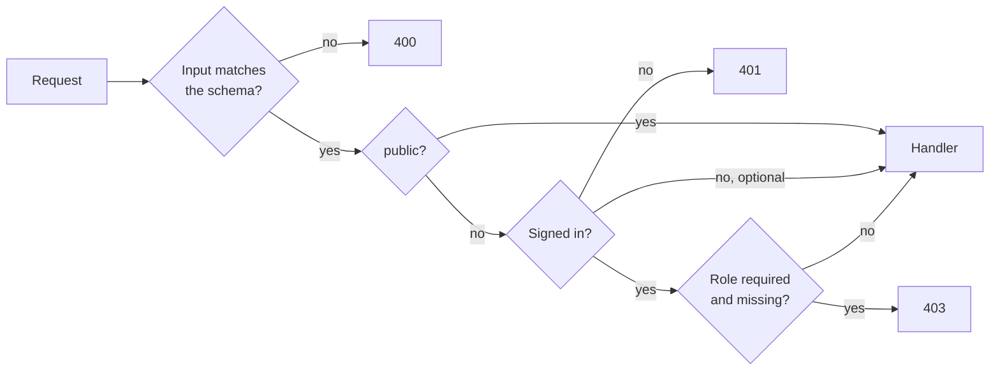

# routes/ — how every endpoint in the NoLie API is written

One factory for all 179 endpoints: signed in by default, input checked before any code runs.

## The problem

An API grows one endpoint at a time, and each new one is a chance to forget the sign-in check or trust what the caller sent. This folder is how we wrote every NoLie endpoint, so the next engineer gets the sign-in check without writing a line, and the input check from the one schema they write anyway.

The factory ([`factory.ts`](factory.ts)) is the only way a route reaches Fastify. The sign-in rule lives in one hook ([`protect.ts`](protect.ts)), registered before any route.

## By the numbers

| Endpoints | Signed in, no auth line written | Declare a schema | AJV vs `zod.parse` |
|:-:|:-:|:-:|:-:|
| **179** | **103** | **179** | **4–19× faster** |

Counted over the endpoints the API serves, 2026-10-29: 46 are public, 4 serve signed-in and guest callers alike, 26 are admin only. The speed is checkout's body, the median of three runs on one machine.

## The rules

| Rule | Enforced in | Proven by |
|---|---|---|
| Signed in unless written public | [`protect.ts`](protect.ts#L67-L91) · [`build.ts`](build.ts#L187) (before every route) | [no session gets a 401](protect.test.ts#L55) · [public gets a 200](protect.test.ts#L35) |
| A buyer stays signed in on guest pages | [`protect.ts`](protect.ts#L74-L79) (`optional`) · [`checkout.ts`](checkout.ts#L76-L77) | the checkout tests, not in this folder |
| Admin endpoints answer only admins | [`protect.ts`](protect.ts#L93-L115) | [non-admin gets a 403](protect.test.ts#L103) |
| Input checked before the code runs, and `null` stays `null` | [`factory.ts`](factory.ts#L116-L152) · [`schemas.ts`](schemas.ts#L23-L52) | the test that resets a seller's fee to the default, not in this folder |
| A signed-in handler always knows who | [`factory.ts`](factory.ts#L82-L86) (the session's type) | the type checker |

## How a request runs

## Why it's built this way

### 1. One Zod schema, checked by AJV

- I write each route's input and output once, in Zod. The schema is optional in the code; every endpoint the API serves declares one. The same schema types the handler, so `request.body` has the type of what was just checked.
- At startup the factory turns each Zod schema into JSON Schema (`z.toJSONSchema`), and Fastify compiles that with its own AJV. Zod never runs while a request is served.
- Response schemas go through the same conversion, so Fastify writes each reply from a serializer compiled from the schema, not from `JSON.stringify`.
- I didn't use `fastify-type-provider-zod`, because it runs Zod on every request instead of AJV. Measured on checkout's body, `zod.parse` took 4 to 19 times as long. Both are under a microsecond, so this is headroom, not a delay a buyer would feel.
- The bridge has one catch. AJV converts types, so a `null` sent for a number arrived as `0`. `schemas.ts` merges the null option into the number's type, so `null` stays `null`.

### 2. Closed unless written open

- Leaving `auth` out means signed in. Opening an endpoint means writing `public: true`, which a reviewer sees in the diff.
- Open endpoints are marked one by one, never by a URL prefix. Early on the hook also skipped any URL starting with `/auth`; every route there already carried `public: true`, so I deleted the prefix (`0960fa236`).

### 3. `optional` is not `public`

- `public` skips the session entirely. A signed-in buyer on a guest page would look like a stranger: no saved address, no wallet.
- `optional` reads the session when there is one and carries on when there isn't. Checkout's four endpoints use it.

### 4. The session's type follows the rule

- A signed-in handler gets `request.session` typed as never null, so its code reads `request.session.user.id` with no check: 107 times, in 39 route files.
- A public or optional handler gets it as possibly null, and the type checker makes it check.

## Start here

1. [`protect.ts`](protect.ts#L60-L122): the whole rule in one hook. Public returns early, then the session, then the role.
2. [`factory.ts`](factory.ts#L116-L185): each schema turned into JSON Schema, and `auth` forwarded into the route's config.
3. [`checkout.ts`](checkout.ts#L76-L127): one real route, written with the factory.

## Bugs I fixed

### Sign-in was skipped on every route with an id in its URL
- **What:** the hook asked whether the route existed using the request's URL (`/listings/abc`), which never matches the pattern (`/listings/:id`). Those routes looked missing, and missing routes skip the sign-in.
- **In production:** no. I found it in local development, before any production release, so it never fired in production.
- **Fix:** `8828aaf9c`

### Clearing a fee override saved it as 0%
- **What:** the `null` that means "back to the default fee" reached the code as `0`.
- **In production:** no. The fee overrides and the fix reached production together (`fa1f3c7d7`), with a test.
- **Fix:** `ba696cca7`

### A stale cookie gave a 500, not a 401
- **What:** a cookie for a session that no longer existed threw, and the hook turned the throw into a server error.
- **In production:** Jan 2 to Jan 29, 2026. It fired: a Sentry alert is how I found it (PR #122).
- **Fix:** `8f64b46ed`, and a follow-up for the same error when better-auth wraps it.

## What I'd change now

The rules held: every endpoint the API serves goes through the factory and the hook. Two things I'd change.

- **Let Fastify infer the types.** `factory.ts` repeats the same seven type parameters five times and the "if it's Zod, infer it" check eight times. Fastify's type providers work a handler's types out from its schema without validating anything. One for Zod would leave the factory a single type parameter: whether the route is public.
- **Ask who's calling before checking the input.** Fastify checks the schema before the hook runs, so a caller who isn't signed in and sends a bad body gets a 400, not a 401. Running the hook at `preValidation` would answer 401 first.
